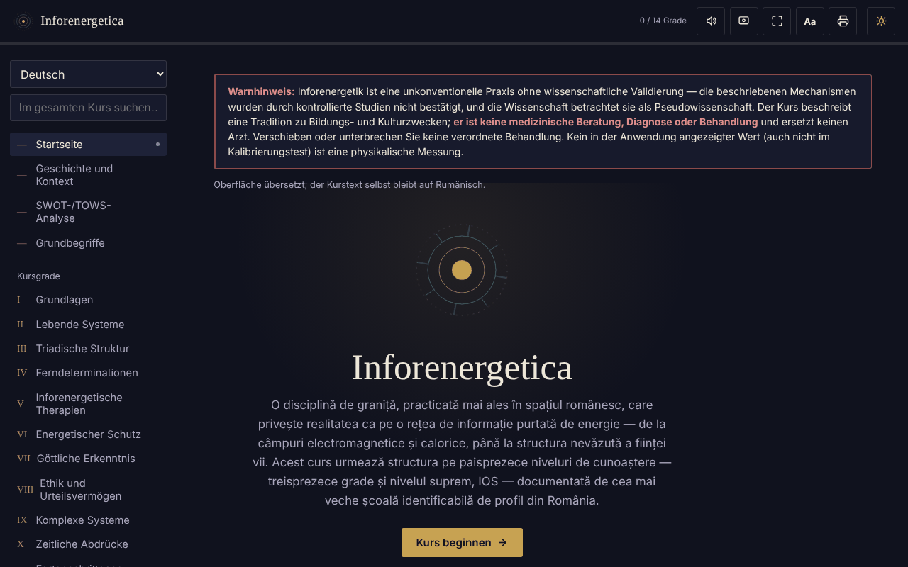

# Inforenergetica — interaktiver Kurs

[English](README.md) · [Română](README.ro.md) · [Français](README.fr.md) · [Italiano](README.it.md) · [Español](README.es.md) · [Português](README.pt.md) · **Deutsch** · [Magyar](README.hu.md)

**Version:** 1.2.6 · **Zuletzt aktualisiert:** 2026-10-23

Oberflächensprachen: **Română, English, Français, Italiano, Español, Português (PT), Deutsch, Magyar**

Ein Offline-Lernkurs in einer einzigen HTML-Datei über Inforenergetik (13 Grade plus die Stufe IOS), mit SWOT-/TOWS-Analyse, Glossar und Selbsttest.

**Live-App:** https://chiuta.github.io/Inforenergetica/

## Warnhinweis

Inforenergetik ist eine unkonventionelle Praxis **ohne wissenschaftliche Validierung**: Die beschriebenen Mechanismen wurden durch kontrollierte Studien nicht bestätigt, und die Wissenschaftsgemeinschaft betrachtet sie als Pseudowissenschaft. Die Anwendung beschreibt eine Tradition zu Bildungs- und Kulturzwecken. **Sie ist weder medizinischer Rat noch Diagnose noch Behandlung** und ersetzt keinen Arzt. Verschiebe oder unterbrich keine verordnete Behandlung. Derselbe Hinweis wird in der Anwendung dauerhaft in jedem Abschnitt angezeigt.

## Was es ist

Eine Bildungssynthese in rumänischer Sprache, gegliedert in 13 aufeinanderfolgende Grade und die „höchste“ Stufe IOS, die der Struktur einer einschlägigen Schule in Rumänien folgt (historische Zuordnung, wie in der Anwendung dargestellt; hier nicht unabhängig geprüft). Die Anwendung erklärt, dass sie nicht das offizielle Material irgendeiner Schule darstellt.

## Funktionen

Im Code und im Browser geprüft:
- Navigation nach Abschnitten: Start, Geschichte und Kontext, SWOT-/TOWS-Analyse, Grundkonzepte, Grade I–XIII, IOS, Persönliches Tagebuch, Kalibrierungstest, Glossar, Selbsttest, Ressourcen.
- Die SWOT-Analyse und die TOWS-Matrix des Gebiets (8 Karten: 4 SWOT + 4 TOWS-Strategien).
- Kalibrierungstest: vier Positionen, in jeder Runde wird eine zufällig ausgewählt (Generator `crypto.getRandomValues`, mit `Math.random` als Ausweichlösung); angezeigt werden Runden, Treffer und die rein zufällig zu erwartende Standardabweichung. Er misst keine Energie und keine Fähigkeit.
- Direkte Links zu Abschnitten (`#grad-3`, `#swot` usw.) und funktionierende „Zurück“-/„Vorwärts“-Schaltflächen des Browsers zwischen den Abschnitten; die Adresse enthält keine personenbezogenen Daten, und es wird nichts gespeichert.
- Suche im gesamten Kurs und im Glossar, unter Ignorierung von Diakritika.
- Selbsttest mit 12 Fragen.
- Persönliches Tagebuch (.txt-Download, Kopieren in die Zwischenablage, Leeren); optional das Kontrollkästchen „Tagebuch in diesem Browser behalten“ (standardmäßig aus); Warnung beim Verlassen der Seite, wenn Text weder heruntergeladen noch gespeichert wurde.
- Textgröße: Die Schaltfläche „Aa“ in der oberen Leiste schaltet zwischen 100 % / 115 % / 130 % um.
- Helles/dunkles Design, Vorlesen (Sprachsynthese des Browsers), Bildschirm aktiv halten (Wake Lock), Vollbild, Drucken / PDF-Export des gesamten Kurses.

## Bedienungsanleitung

1. Öffne die Seite und lies den Warnhinweis oben.
2. Wähle einen Abschnitt im Menü links (auf dem Handy: die Schaltfläche ☰; Escape schließt es).
3. Gehe die Grade der Reihe nach durch oder suche einen Begriff unter „Im gesamten Kurs suchen“.
4. Tippe im „Kalibrierungstest“ auf eine Position; das Ergebnis ist rein statistisch, auf lange Sicht ~25 %.
5. Schreibe im „Persönlichen Tagebuch“ deine Notizen und klicke vor dem Schließen der Seite auf „Tagebuch herunterladen“.
6. Der „Selbsttest“ prüft nur das Verständnis des Kursmaterials.
7. Die Drucker-Schaltfläche öffnet den Druckdialog für den gesamten Kurs.

## Datenschutz und Netzwerk

- Speicherung: Standardmäßig speichert die Anwendung nichts (auch kein `sessionStorage`, IndexedDB oder Cookies). Die einzige Ausnahme ist die Option „Tagebuch in diesem Browser behalten“, die du selbst aktivierst: Dann wird der Tagebuchtext in `localStorage` gespeichert (Schlüssel `inforenergetica-jurnal` und `inforenergetica-jurnal-pastrat`), nur auf diesem Gerät; Abwählen oder „Leeren“ löscht ihn. Ist die Option aus, gehen Tagebuch und Fortschritt beim Schließen/Neuladen verloren, und das Tagebuch bleibt nur erhalten, wenn du es herunterlädst. Die Textgröße wird nicht gemerkt.
- Netzwerk: Ich habe im Code kein `fetch`, kein Skript, keine Schrift, kein Bild und keinen externen Link gefunden; es gibt keine externen Hosts. Die CSP der Seite blockiert jede externe Verbindung.
- Berechtigungen: keine von der Anwendung angefordert. Optional, beim Drücken der Schaltflächen: Sprachsynthese, Wake Lock, Vollbild, Zwischenablage, Vibration (auf Geräten, die sie haben), natives Teilen (Schaltfläche „Ergebnis teilen“, nur wenn der Browser es anbietet).
- Keine Telemetrie, kein Konto.

## Grenzen und Warnungen

- Der Inhalt gibt die Behauptungen der Tradition so wieder, wie sie sie formuliert; sie sind wissenschaftlich nicht bewiesen.
- „Inforenergetische Kraft“, „Diagnose“ und „Teledetermination“ sind keine physikalischen Messungen.
- Die historischen Verweise auf Personen und Organisationen im Abschnitt „Geschichte und Kontext“ stammen aus dem Text und wurden nicht unabhängig geprüft.
- Der Fortschritt („X / 14 Grade“) zeigt nur die in der aktuellen Sitzung geöffneten Abschnitte.

## Lokale Ausführung / offline

Lade `index.html` herunter und öffne sie im Browser; sie benötigt weder Internet noch Server.

## Verlauf / Changelog

### 1.2.4 — 2026-10-22

fff-kit 1.1.4: Touch-Ziele und Mindestschriftgröße. Touch-Ziele/Text in der App korrigiert.

### 1.2.3 — 2026-10-22

fff-kit 1.1.2: PBKDF2 mit 600.000 Iterationen, Schutz vor Clickjacking.

### 1.2.2 — 2026-10-22
- Die confirm()/prompt()-Fenster des Browsers durch eigene, in die 8 Sprachen übersetzte Dialoge ersetzt (Tagebuch leeren); Text von mindestens 12 px auf Mobilgeräten.

### 1.1.0 — 2026-10-14
- Datensicherung und Datenkennzeichnung (fff-kit).

### 12. Oktober 2026 — Version 1.0.0
- 1.0.0 — 2026-10-12: Die Version und das Datum der letzten Aktualisierung werden in der Anwendung angezeigt

### 11. Oktober 2026 (Rev. 3)
- Die Navigation zwischen den Abschnitten spiegelt sich in der Adresse (`#id`) wider: direkte Links, funktionierende „Zurück“-/„Vorwärts“-Schaltfläche, ein ungültiger oder unbekannter Hash führt zum Start. Es wird keine Speicherung hinzugefügt. CSP: Hash neu berechnet.

### 11. Oktober 2026 (Rev. 2)
- Tagebuch: optionale lokale Speicherung (Opt-in) und Warnung beim Verlassen der Seite mit ungespeichertem Text; das Statusfeld wird von Screenreadern angesagt (`role="status"`).
- Schaltfläche „Aa“ für die Textgröße (100/115/130 %); die obere Leiste überschreitet bei 360 px nicht die Breite.
- Der Hinweis auf die fehlende wissenschaftliche Validierung bleibt unverändert.

### 11. Oktober 2026
- Persönliches Tagebuch: Unter dem Textfeld werden nun dauerhaft die Zeichenanzahl und der Hinweis angezeigt, dass der Text nicht automatisch gespeichert wird (zuvor blieb das Statusfeld bis zu einer Aktion leer).
- Barrierefreiheit: Die obere Leiste ist ein `<header>`; axe-core meldet 0 Verstöße bei 1280 und 360 px.
- CSP: `script-src` verwendet einen SHA-256-Hash statt `'unsafe-inline'` (die Anwendung hat keine Inline-Handler).
- Der Hinweis auf die fehlende wissenschaftliche Validierung bleibt unverändert.

## Lizenz

MIT — siehe Datei LICENSE.

## Autor

Alexio — Alexandru-Ionuț Chiuță, Kontakt: alexio@trom.tf

## Zusammenfassung

Inforenergetica ist ein Offline-Bildungskurs in einer einzigen Datei, in rumänischer Sprache, über „Inforenergetik“, eine unkonventionelle Praxis ohne wissenschaftliche Validierung (von der Wissenschaftsgemeinschaft als Pseudowissenschaft betrachtet). Er umfasst 13 Grade plus eine höchste Stufe, eine SWOT-/TOWS-Analyse, ein Glossar, ein Quiz und ein zufallsbasiertes „Kalibrierungs“-Spiel, das nichts misst. Ein dauerhafter Hinweis stellt klar, dass es sich nicht um medizinischen Rat handelt. Keine Speicherung, keine externen Anfragen, keine Telemetrie.
