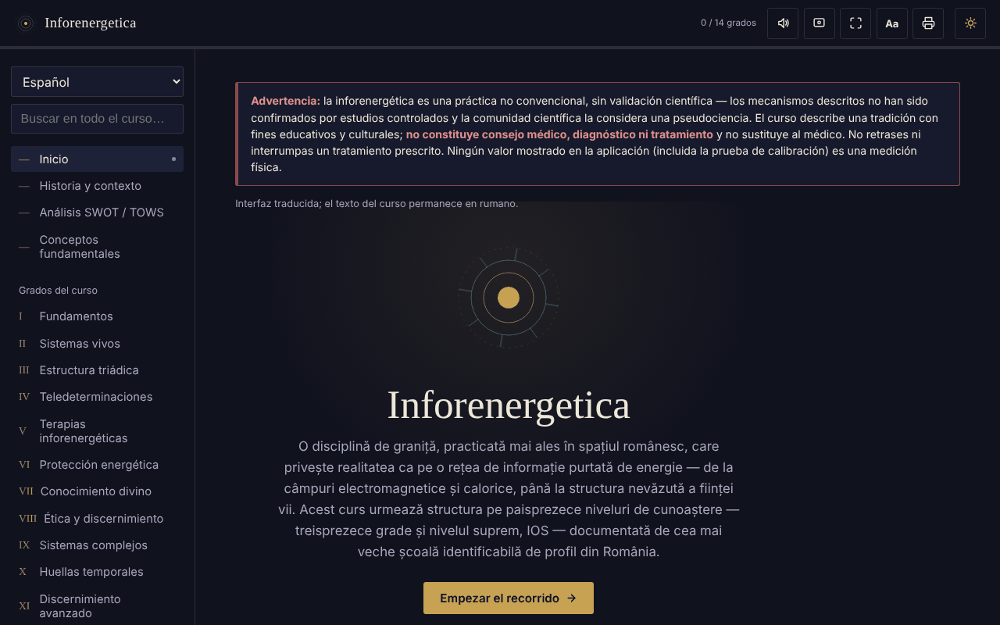

# Inforenergetica — curso interactivo

[English](README.md) · [Română](README.ro.md) · [Français](README.fr.md) · [Italiano](README.it.md) · **Español** · [Português](README.pt.md) · [Deutsch](README.de.md) · [Magyar](README.hu.md)

**Versión:** 1.2.5 · **Última actualización:** 2026-10-23

Idiomas de la interfaz: **Română, English, Français, Italiano, Español, Português (PT), Deutsch, Magyar**

Curso educativo sin conexión, en un único archivo HTML, sobre la inforenergética (13 grados más el nivel IOS), con análisis SWOT/TOWS, glosario y autoevaluación.

**Aplicación en línea:** https://chiuta.github.io/Inforenergetica/

## Advertencia

La inforenergética es una práctica no convencional, **sin validación científica**: los mecanismos descritos no han sido confirmados por estudios controlados y la comunidad científica la considera una pseudociencia. La aplicación describe una tradición con fines educativos y culturales. **No es consejo médico, diagnóstico ni tratamiento** y no sustituye al médico. No retrases ni interrumpas un tratamiento prescrito. La misma advertencia se muestra de forma permanente en la aplicación, en cada sección.

## Qué es

Una síntesis educativa en rumano, estructurada en 13 grados sucesivos y el nivel «supremo» IOS, que sigue la estructura de una escuela del ámbito en Rumanía (atribución histórica presentada en la aplicación, no verificada aquí de forma independiente). La aplicación declara que no representa el material oficial de ninguna escuela.

## Funciones

Verificadas en el código y en el navegador:
- Navegación por secciones: Inicio, Historia y contexto, Análisis SWOT / TOWS, Conceptos fundamentales, Grados I–XIII, IOS, Diario personal, Prueba de calibración, Glosario, Autoevaluación, Recursos.
- El análisis SWOT y la matriz TOWS del ámbito (8 tarjetas: 4 SWOT + 4 estrategias TOWS).
- Prueba de calibración: cuatro posiciones, una elegida al azar en cada ronda (generador `crypto.getRandomValues`, con `Math.random` como respaldo); muestra rondas, aciertos y la desviación típica esperada por puro azar. No mide ninguna energía ni habilidad.
- Enlaces directos a las secciones (`#grad-3`, `#swot`, etc.) y botones «Atrás»/«Adelante» del navegador operativos entre secciones; la dirección no contiene datos personales y no se almacena nada.
- Búsqueda en todo el curso y en el glosario, ignorando los signos diacríticos.
- Autoevaluación de 12 preguntas.
- Diario personal (descarga .txt, copia al portapapeles, vaciado); opcionalmente, casilla «Conservar el diario en este navegador» (desactivada por defecto); aviso al salir de la página si hay texto sin descargar ni conservar.
- Tamaño del texto: el botón «Aa» de la barra superior recorre 100 % / 115 % / 130 %.
- Tema claro/oscuro, lectura en voz alta (síntesis de voz del navegador), pantalla activa (Wake Lock), pantalla completa, impresión / exportación a PDF de todo el curso.

## Manual de uso

1. Abre la página y lee la advertencia de la parte superior.
2. Elige una sección en el menú de la izquierda (en móvil: el botón ☰; Escape lo cierra).
3. Recorre los grados en orden o busca un término en «Buscar en todo el curso».
4. En «Prueba de calibración» pulsa una posición; el resultado es puramente estadístico, ~25 % a largo plazo.
5. En «Diario personal» escribe tus notas y pulsa «Descargar el diario» antes de cerrar la página.
6. «Autoevaluación» solo comprueba la comprensión del material del curso.
7. El botón de la impresora abre el cuadro de impresión de todo el curso.

## Privacidad y red

- Almacenamiento: por defecto la aplicación no almacena nada (ni `sessionStorage`, IndexedDB o cookies). La única excepción es la opción «Conservar el diario en este navegador», que activas tú: entonces el texto del diario se guarda en `localStorage` (claves `inforenergetica-jurnal` e `inforenergetica-jurnal-pastrat`), solo en este dispositivo; al desmarcarla o con «Vaciar» se elimina. Si la opción está desactivada, el diario y el progreso se pierden al cerrar/recargar, y el diario solo se conserva si lo descargas. El tamaño del texto no se recuerda.
- Red: no he encontrado en el código ningún `fetch`, script, fuente, imagen ni enlace externo; no hay hosts externos. La CSP de la página bloquea cualquier conexión externa.
- Permisos: ninguno solicitado por la aplicación. Opcionalmente, al pulsar los botones: síntesis de voz, Wake Lock, pantalla completa, portapapeles, vibración (en dispositivos que la tengan), uso compartido nativo (botón «Compartir el resultado», solo si el navegador lo ofrece).
- Cero telemetría, sin cuenta.

## Límites y advertencias

- El contenido presenta las afirmaciones de la tradición tal como ella las formula; no están demostradas científicamente.
- La «potencia inforenergética», el «diagnóstico» y la «teledeterminación» no son mediciones físicas.
- Las referencias históricas a personas y organizaciones de la sección «Historia y contexto» proceden del texto y no se han verificado de forma independiente.
- El progreso («X / 14 grados») muestra solo las secciones abiertas en la sesión actual.

## Ejecución local / sin conexión

Descarga `index.html` y ábrelo en el navegador; no necesita internet ni servidor.

## Historial / Changelog

### 1.2.4 — 2026-10-22

fff-kit 1.1.4: áreas táctiles y texto mínimo. Áreas táctiles/texto corregidos en la aplicación.

### 1.2.3 — 2026-10-22

fff-kit 1.1.2: PBKDF2 con 600.000 iteraciones, protección anti-clickjacking.

### 1.2.2 — 2026-10-22
- Los cuadros confirm()/prompt() del navegador sustituidos por diálogos propios traducidos a los 8 idiomas (vaciar el diario); texto de al menos 12 px en móvil.

### 1.1.0 — 2026-10-14
- Copia de seguridad y etiquetado de datos (fff-kit).

### 12 de octubre de 2026 — versión 1.0.0
- 1.0.0 — 2026-10-12: la versión y la fecha de la última actualización se muestran en la aplicación

### 11 de octubre de 2026 (rev. 3)
- La navegación entre secciones se refleja en la dirección (`#id`): enlaces directos, botones «Atrás»/«Adelante» operativos, un hash no válido o desconocido lleva a Inicio. No se añade almacenamiento. CSP: hash recalculado.

### 11 de octubre de 2026 (rev. 2)
- Diario: conservación local opcional (opt-in) y aviso al salir de la página con texto sin guardar; el campo de estado es anunciado por los lectores de pantalla (`role="status"`).
- Botón «Aa» para el tamaño del texto (100/115/130 %); la barra superior no sobrepasa el ancho a 360 px.
- La advertencia sobre la falta de validación científica permanece sin cambios.

### 11 de octubre de 2026
- Diario personal: bajo el campo de texto se muestran ahora de forma permanente el número de caracteres y el hecho de que el texto no se guarda automáticamente (antes el campo de estado quedaba vacío hasta realizar una acción).
- Accesibilidad: la barra superior es un `<header>`; axe-core informa de 0 infracciones a 1280 y 360 px.
- CSP: `script-src` usa un hash SHA-256 en lugar de `'unsafe-inline'` (la aplicación no tiene manejadores en línea).
- La advertencia sobre la falta de validación científica permanece sin cambios.

## Licencia

MIT — véase el archivo LICENSE.

## Autor

Alexio — Alexandru-Ionuț Chiuță, contacto: alexio@trom.tf

## Resumen

Inforenergetica es un curso educativo en rumano, en un único archivo y sin conexión, sobre la «inforenergética», una práctica no convencional sin validación científica (considerada pseudociencia por la comunidad científica). Incluye 13 grados más un nivel superior, un análisis SWOT/TOWS, un glosario, un cuestionario y un juego de «calibración» basado en el azar que no mide nada. Una advertencia permanente indica que no es consejo médico. Sin almacenamiento, sin solicitudes externas, sin telemetría.
