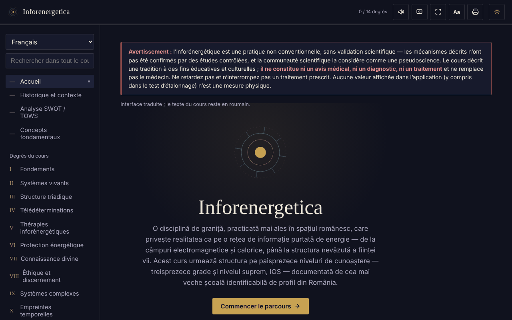

# Inforenergetica — cours interactif

[English](README.md) · [Română](README.ro.md) · **Français** · [Italiano](README.it.md) · [Español](README.es.md) · [Português](README.pt.md) · [Deutsch](README.de.md) · [Magyar](README.hu.md)

**Version :** 2.0.2 · **Dernière mise à jour :** 2026-10-27

**Statut :** stable ; étude descriptive (aucune allégation thérapeutique) · **Hors ligne :** complet (aucune requête réseau)

Langues de l'interface : **Română, English, Français, Italiano, Español, Português (PT), Deutsch, Magyar**

Cours éducatif hors ligne, dans un seul fichier HTML, sur l'inforénergétique (13 degrés plus le niveau IOS), avec analyse SWOT/TOWS, glossaire et autoévaluation.

**Application en ligne :** https://chiuta.github.io/Inforenergetica/

## Avertissement

L'inforénergétique est une pratique non conventionnelle, **sans validation scientifique** : les mécanismes décrits n'ont pas été confirmés par des études contrôlées et la communauté scientifique la considère comme une pseudoscience. L'application décrit une tradition, à des fins éducatives et culturelles. **Elle ne constitue ni un avis médical, ni un diagnostic, ni un traitement** et ne remplace pas un médecin. Ne retardez ni n'interrompez un traitement prescrit. Le même avertissement est affiché en permanence dans l'application, sur chaque section.

## De quoi s'agit-il

Une synthèse éducative en roumain, structurée en 13 degrés successifs et un niveau « suprême » IOS, qui suit la structure d'une école spécialisée de Roumanie (attribution historique présentée dans l'application, non vérifiée de façon indépendante ici). L'application déclare ne pas représenter le matériel officiel d'une école.

## Fonctions

Vérifiées dans le code et dans le navigateur :
- Navigation par sections : Accueil, Historique et contexte, Analyse SWOT / TOWS, Concepts fondamentaux, Degrés I–XIII, IOS, Journal personnel, Test de calibrage, Glossaire, Autoévaluation, Ressources.
- L'analyse SWOT et la matrice TOWS du domaine (8 cartes : 4 SWOT + 4 stratégies TOWS).
- Test de calibrage : quatre positions, dont une choisie au hasard à chaque tour (générateur `crypto.getRandomValues`, avec repli sur `Math.random`) ; il affiche les tours, les réussites et l'écart type attendu par le seul hasard. Il ne mesure aucune énergie ni aucune capacité.
- Liens directs vers les sections (`#grad-3`, `#swot`, etc.) et boutons « Précédent »/« Suivant » du navigateur fonctionnels entre les sections ; l'adresse ne contient aucune donnée personnelle et rien n'est stocké.
- Recherche dans tout le cours et dans le glossaire, en ignorant les signes diacritiques.
- Autoévaluation de 12 questions.
- Journal personnel (téléchargement .txt, copie dans le presse-papiers, effacement) ; en option, case « Conserver le journal dans ce navigateur » (désactivée par défaut) ; avertissement à la fermeture de la page s'il reste du texte ni téléchargé ni conservé.
- Taille du texte : le bouton « Aa » de la barre supérieure fait défiler 100 % / 115 % / 130 %.
- Thème clair/sombre, lecture à voix haute (synthèse vocale du navigateur), écran actif (Wake Lock), plein écran, impression / export PDF de l'ensemble du cours.

## Mode d'emploi

1. Ouvrez la page et lisez l'avertissement en haut.
2. Choisissez une section dans le menu de gauche (sur mobile : le bouton ☰ ; Échap le ferme).
3. Parcourez les degrés dans l'ordre ou cherchez un terme dans « Rechercher dans tout le cours ».
4. Dans « Test de calibrage », appuyez sur une position ; le résultat est purement statistique, ~25 % à long terme.
5. Dans « Journal personnel », écrivez vos notes et appuyez sur « Télécharger le journal » avant de fermer la page.
6. « Autoévaluation » ne vérifie que la compréhension du contenu du cours.
7. Le bouton d'imprimante ouvre la boîte de dialogue d'impression pour l'ensemble du cours.

## Confidentialité et réseau

- Stockage : par défaut, l'application ne stocke rien (ni `sessionStorage`, IndexedDB ou cookies). La seule exception est l'option « Conserver le journal dans ce navigateur », que vous activez vous-même : le texte du journal est alors enregistré dans `localStorage` (clés `inforenergetica-jurnal` et `inforenergetica-jurnal-pastrat`), uniquement sur cet appareil ; la décocher ou « Effacer » le supprime. Si l'option est désactivée, le journal et la progression sont perdus à la fermeture/au rechargement, et le journal n'est conservé que si vous le téléchargez. La taille du texte n'est pas mémorisée.
- Réseau : je n'ai trouvé dans le code aucun `fetch`, script, police, image ou lien externe ; il n'y a aucun hôte externe. La CSP de la page bloque toute connexion externe.
- Autorisations : aucune demandée par l'application. En option, lorsque vous appuyez sur les boutons : synthèse vocale, Wake Lock, plein écran, presse-papiers, vibrations (sur les appareils qui en disposent), partage natif (bouton « Partager le résultat », uniquement si le navigateur le propose).
- Zéro télémétrie, aucun compte.

## Limites et avertissements

- Le contenu présente les affirmations de la tradition telles qu'elle les formule ; elles ne sont pas prouvées scientifiquement.
- La « puissance inforénergétique », le « diagnostic » et la « télédétermination » ne sont pas des mesures physiques.
- Les références historiques à des personnes et organisations de la section « Historique et contexte » proviennent du texte et n'ont pas été vérifiées de façon indépendante.
- La progression (« X / 14 degrés ») n'indique que les sections ouvertes durant la session en cours.

## Exécution locale / hors ligne

Téléchargez `index.html` et ouvrez-le dans un navigateur ; il n'a besoin ni d'internet ni d'un serveur.

## Historique / Changelog

### 1.2.4 — 2026-10-22

fff-kit 1.1.4 : cibles tactiles et taille de texte minimale. Cibles tactiles/texte corrigés dans l’application.

### 1.2.3 — 2026-10-22

fff-kit 1.1.2 : PBKDF2 600 000 itérations, protection anti-clickjacking.

### 1.2.2 — 2026-10-22
- Les boîtes confirm()/prompt() du navigateur remplacées par des dialogues propres, traduits dans les 8 langues (vidage du journal); texte d'au moins 12 px sur mobile.

### 1.1.0 — 2026-10-14
- Sauvegarde et étiquetage des données (fff-kit).

### 12 octobre 2026 — version 1.0.0
- 1.0.0 — 2026-10-12 : la version et la date de la dernière mise à jour sont affichées dans l'application

### 11 octobre 2026 (rév. 3)
- La navigation entre les sections se reflète dans l'adresse (`#id`) : liens directs, boutons « Précédent »/« Suivant » fonctionnels, un hash invalide ou inconnu mène à l'Accueil. Aucun stockage n'est ajouté. CSP : hash recalculé.

### 11 octobre 2026 (rév. 2)
- Journal : conservation locale facultative (opt-in) et avertissement à la fermeture de la page avec du texte non enregistré ; le champ d'état est annoncé par les lecteurs d'écran (`role="status"`).
- Bouton « Aa » pour la taille du texte (100/115/130 %) ; la barre supérieure ne dépasse pas la largeur à 360 px.
- L'avertissement concernant l'absence de validation scientifique reste inchangé.

### 11 octobre 2026
- Journal personnel : sous le champ de texte s'affichent désormais en permanence le nombre de caractères et le fait que le texte n'est pas enregistré automatiquement (auparavant le champ d'état restait vide jusqu'à une action).
- Accessibilité : la barre supérieure est un `<header>` ; axe-core ne signale aucune violation à 1280 et 360 px.
- CSP : `script-src` utilise un hash SHA-256 au lieu de `'unsafe-inline'` (l'application n'a pas de gestionnaires en ligne).
- L'avertissement concernant l'absence de validation scientifique reste inchangé.

## Licence

MIT — voir le fichier LICENSE.

## Auteur

Alexio — Alexandru-Ionuț Chiuță, contact : alexio@trom.tf

## Résumé

Inforenergetica est un cours éducatif en roumain, dans un seul fichier, hors ligne, sur l'« inforénergétique », une pratique non conventionnelle sans validation scientifique (considérée comme une pseudoscience par la communauté scientifique). Il comprend 13 degrés plus un niveau supérieur, une analyse SWOT/TOWS, un glossaire, un quiz et un jeu de « calibrage » fondé sur le hasard qui ne mesure rien. Un avertissement permanent précise qu'il ne s'agit pas d'un avis médical. Aucun stockage, aucune requête externe, aucune télémétrie.
