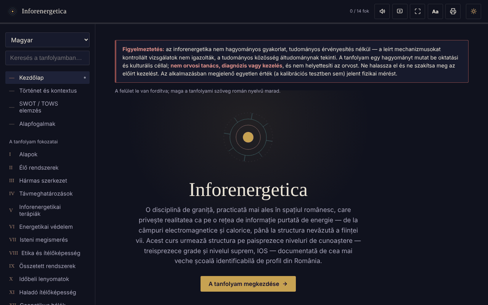

# Inforenergetica — interaktív tanfolyam

[English](README.md) · [Română](README.ro.md) · [Français](README.fr.md) · [Italiano](README.it.md) · [Español](README.es.md) · [Português](README.pt.md) · [Deutsch](README.de.md) · **Magyar**

**Verzió:** 1.2.4 · **Utolsó frissítés:** 2026-10-22

A felület nyelvei: **Română, English, Français, Italiano, Español, Português (PT), Deutsch, Magyar**

Offline oktatási tanfolyam egyetlen HTML-fájlban az inforenergetikáról (13 fokozat és az IOS szint), SWOT/TOWS-elemzéssel, szószedettel és önértékeléssel.

**Online alkalmazás:** https://chiuta.github.io/Inforenergetica/

## Figyelmeztetés

Az inforenergetika egy nem konvencionális gyakorlat, **tudományos validálás nélkül**: a leírt mechanizmusokat kontrollált vizsgálatok nem erősítették meg, és a tudományos közösség áltudománynak tekinti. Az alkalmazás egy hagyományt mutat be oktatási és kulturális céllal. **Nem orvosi tanács, diagnózis vagy kezelés**, és nem helyettesíti az orvost. Ne halaszd el és ne szakítsd meg az előírt kezelést. Ugyanez a figyelmeztetés az alkalmazásban állandóan látható, minden szakaszban.

## Mi ez

Román nyelvű oktatási összefoglaló, 13 egymást követő fokozatra és a „legfelső” IOS szintre tagolva, amely egy romániai szakmai iskola felépítését követi (az alkalmazásban bemutatott történeti hivatkozás, amelyet itt nem ellenőriztünk függetlenül). Az alkalmazás kijelenti, hogy nem képviseli egyetlen iskola hivatalos anyagát sem.

## Funkciók

A kódban és a böngészőben ellenőrizve:
- Navigáció szakaszok szerint: Kezdőlap, Történet és háttér, SWOT / TOWS-elemzés, Alapfogalmak, I–XIII. fokozat, IOS, Személyes napló, Kalibrációs teszt, Szószedet, Önértékelés, Források.
- A terület SWOT-elemzése és TOWS-mátrixa (8 kártya: 4 SWOT + 4 TOWS-stratégia).
- Kalibrációs teszt: négy pozíció, minden körben egyet véletlenszerűen választ ki (`crypto.getRandomValues` generátor, `Math.random` tartalékkal); megjeleníti a köröket, a találatokat és a puszta véletlentől várható szórást. Nem mér semmilyen energiát vagy képességet.
- Közvetlen hivatkozások a szakaszokra (`#grad-3`, `#swot` stb.), és a böngésző „Vissza”/„Előre” gombja működik a szakaszok között; a cím nem tartalmaz személyes adatot, és semmi nem kerül tárolásra.
- Keresés a teljes tanfolyamban és a szószedetben, az ékezetek figyelmen kívül hagyásával.
- Önértékelés 12 kérdéssel.
- Személyes napló (.txt letöltése, vágólapra másolás, törlés); opcionálisan a „Napló megőrzése ebben a böngészőben” jelölőnégyzet (alapértelmezés szerint ki van kapcsolva); figyelmeztetés az oldal elhagyásakor, ha van le nem töltött és meg nem őrzött szöveg.
- Szövegméret: a felső sáv „Aa” gombja 100% / 115% / 130% között lépked.
- Világos/sötét téma, felolvasás (a böngésző beszédszintézise), aktív képernyő (Wake Lock), teljes képernyő, a teljes tanfolyam nyomtatása / PDF-exportja.

## Használati útmutató

1. Nyisd meg az oldalt, és olvasd el a felül lévő figyelmeztetést.
2. Válassz egy szakaszt a bal oldali menüből (mobilon: a ☰ gomb; az Escape bezárja).
3. Haladj végig a fokozatokon sorrendben, vagy keress egy kifejezést a „Keresés a teljes tanfolyamban” mezőben.
4. A „Kalibrációs teszt” részben nyomj meg egy pozíciót; az eredmény tisztán statisztikai, hosszú távon ~25%.
5. A „Személyes napló” részben írd le a jegyzeteidet, és az oldal bezárása előtt nyomd meg a „Napló letöltése” gombot.
6. Az „Önértékelés” csak a tananyag megértését ellenőrzi.
7. A nyomtató gomb megnyitja a teljes tanfolyam nyomtatási párbeszédablakát.

## Adatvédelem és hálózat

- Tárolás: alapértelmezés szerint az alkalmazás semmit sem tárol (sem `sessionStorage`-ot, IndexedDB-t vagy sütiket). Az egyetlen kivétel a „Napló megőrzése ebben a böngészőben” opció, amelyet te kapcsolsz be: ilyenkor a napló szövege a `localStorage`-ba kerül (`inforenergetica-jurnal` és `inforenergetica-jurnal-pastrat` kulcsok), csak ezen az eszközön; a jelölés megszüntetése vagy a „Törlés” eltávolítja. Ha az opció ki van kapcsolva, a napló és a haladás bezáráskor/újratöltéskor elvész, a napló pedig csak akkor marad meg, ha letöltöd. A szövegméretet nem jegyzi meg.
- Hálózat: a kódban nem találtam `fetch`-t, szkriptet, betűtípust, képet vagy külső hivatkozást; nincsenek külső gazdák. Az oldal CSP-je minden külső kapcsolatot blokkol.
- Engedélyek: az alkalmazás egyet sem kér. Opcionálisan, a gombok megnyomásakor: beszédszintézis, Wake Lock, teljes képernyő, vágólap, rezgés (az ezzel rendelkező eszközökön), natív megosztás („Eredmény megosztása” gomb, csak ha a böngésző kínálja).
- Nulla telemetria, fiók nélkül.

## Korlátok és figyelmeztetések

- A tartalom a hagyomány állításait úgy mutatja be, ahogyan azt a hagyomány megfogalmazza; ezek tudományosan nem bizonyítottak.
- Az „inforenergetikai erő”, a „diagnózis” és a „teledetermináció” nem fizikai mérések.
- A „Történet és háttér” szakaszban szereplő személyekre és szervezetekre vonatkozó történeti utalások a szövegből származnak, és nem lettek függetlenül ellenőrizve.
- A haladás („X / 14 fokozat”) csak az aktuális munkamenetben megnyitott szakaszokat mutatja.

## Futtatás helyben / offline

Töltsd le az `index.html` fájlt, és nyisd meg a böngészőben; nincs szüksége internetre vagy szerverre.

## Előzmények / Changelog

### 1.2.4 — 2026-10-22

fff-kit 1.1.4: érintési célok és minimális szövegméret. Érintési célok/szöveg javítva az alkalmazásban.

### 1.2.3 — 2026-10-22

fff-kit 1.1.2: PBKDF2 600 000 iterációval, clickjacking elleni védelem.

### 1.2.2 — 2026-10-22
- A böngésző confirm()/prompt() ablakait saját, mind a 8 nyelvre lefordított párbeszédablakok váltják (a napló törlése); legalább 12 px-es szöveg mobilon.

### 1.1.0 — 2026-10-14
- Biztonsági mentés és adatcímkézés (fff-kit).

### 2026. október 12. — 1.0.0 verzió
- 1.0.0 — 2026-10-12: a verzió és az utolsó frissítés dátuma megjelenik az alkalmazásban

### 2026. október 11. (3. átdolgozás)
- A szakaszok közötti navigáció megjelenik a címben (`#id`): közvetlen hivatkozások, működő „Vissza”/„Előre” gomb, érvénytelen vagy ismeretlen hash a Kezdőlapra visz. Tárolás nem került hozzáadásra. CSP: a hash újraszámolva.

### 2026. október 11. (2. átdolgozás)
- Napló: opcionális (opt-in) helyi megőrzés és figyelmeztetés az oldal elhagyásakor mentetlen szöveg esetén; az állapotmezőt a képernyőolvasók felolvassák (`role="status"`).
- „Aa” gomb a szövegmérethez (100/115/130%); a felső sáv 360 px-en nem lóg túl a szélességen.
- A tudományos validálás hiányára vonatkozó figyelmeztetés változatlan marad.

### 2026. október 11.
- Személyes napló: a szövegmező alatt mostantól állandóan megjelenik a karakterek száma és az a tény, hogy a szöveg nem mentődik automatikusan (korábban az állapotmező egy műveletig üres maradt).
- Akadálymentesség: a felső sáv `<header>`; az axe-core 0 szabálysértést jelez 1280 és 360 px-en.
- CSP: a `script-src` SHA-256 hash-t használ az `'unsafe-inline'` helyett (az alkalmazásban nincsenek beágyazott eseménykezelők).
- A tudományos validálás hiányára vonatkozó figyelmeztetés változatlan marad.

## Licenc

MIT — lásd a LICENSE fájlt.

## Szerző

Alexio — Alexandru-Ionuț Chiuță, kapcsolat: alexio@trom.tf

## Összefoglaló

Az Inforenergetica egyetlen fájlból álló, offline, román nyelvű oktatási tanfolyam az „inforenergetikáról”, egy tudományos validálás nélküli, nem konvencionális gyakorlatról (a tudományos közösség áltudománynak tekinti). 13 fokozatot és egy legfelső szintet, SWOT/TOWS-elemzést, szószedetet, kvízt és egy véletlenen alapuló „kalibrációs” játékot tartalmaz, amely semmit sem mér. Egy állandó figyelmeztetés kimondja, hogy nem orvosi tanács. Nincs tárolás, nincsenek külső kérések, nincs telemetria.
