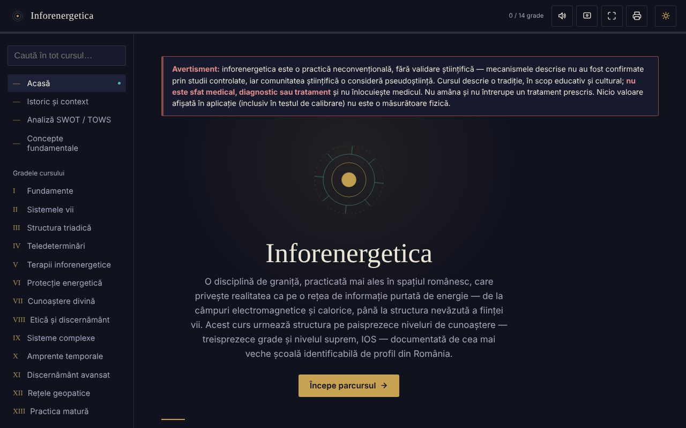

# Inforenergetica — corso interattivo

[English](README.md) · [Română](README.ro.md) · [Français](README.fr.md) · **Italiano** · [Español](README.es.md) · [Português](README.pt.md) · [Deutsch](README.de.md) · [Magyar](README.hu.md)

**Versione:** 1.2.0 · **Ultimo aggiornamento:** 2026-10-19

Lingue dell'interfaccia: **Română, English, Français, Italiano, Español, Português (PT), Deutsch, Magyar**

Corso educativo offline, in un unico file HTML, sull'inforenergetica (13 gradi più il livello IOS), con analisi SWOT/TOWS, glossario e autovalutazione.

**App online:** https://chiuta.github.io/Inforenergetica/

## Avvertenza

L'inforenergetica è una pratica non convenzionale, **priva di validazione scientifica**: i meccanismi descritti non sono stati confermati da studi controllati e la comunità scientifica la considera una pseudoscienza. L'applicazione descrive una tradizione, a scopo educativo e culturale. **Non è un consiglio medico, una diagnosi o una terapia** e non sostituisce il medico. Non rimandare né interrompere una terapia prescritta. La stessa avvertenza è mostrata in modo permanente nell'applicazione, in ogni sezione.

## Che cos'è

Una sintesi educativa in lingua romena, strutturata in 13 gradi successivi e nel livello «supremo» IOS, che segue la struttura di una scuola di settore in Romania (attribuzione storica presentata nell'applicazione, non verificata in modo indipendente qui). L'applicazione dichiara di non rappresentare il materiale ufficiale di alcuna scuola.

## Funzioni

Verificate nel codice e nel browser:
- Navigazione per sezioni: Home, Storia e contesto, Analisi SWOT / TOWS, Concetti fondamentali, Gradi I–XIII, IOS, Diario personale, Test di calibrazione, Glossario, Autovalutazione, Risorse.
- L'analisi SWOT e la matrice TOWS del settore (8 schede: 4 SWOT + 4 strategie TOWS).
- Test di calibrazione: quattro posizioni, una scelta a caso a ogni turno (generatore `crypto.getRandomValues`, con ripiego su `Math.random`); mostra turni, centri e la deviazione standard attesa per puro caso. Non misura alcuna energia o abilità.
- Collegamenti diretti alle sezioni (`#grad-3`, `#swot` ecc.) e pulsanti «Indietro»/«Avanti» del browser funzionanti tra le sezioni; l'indirizzo non contiene dati personali e non viene memorizzato nulla.
- Ricerca in tutto il corso e nel glossario, ignorando i segni diacritici.
- Autovalutazione con 12 domande.
- Diario personale (download .txt, copia negli appunti, svuotamento); facoltativamente, la casella «Conserva il diario in questo browser» (disattivata per impostazione predefinita); avviso all'uscita dalla pagina se c'è testo non scaricato e non conservato.
- Dimensione del testo: il pulsante «Aa» nella barra superiore passa ciclicamente da 100% a 115% a 130%.
- Tema chiaro/scuro, lettura ad alta voce (sintesi vocale del browser), schermo attivo (Wake Lock), schermo intero, stampa / esportazione in PDF dell'intero corso.

## Guida all'uso

1. Apri la pagina e leggi l'avvertenza in alto.
2. Scegli una sezione dal menu a sinistra (su mobile: il pulsante ☰; Esc lo chiude).
3. Percorri i gradi in ordine oppure cerca un termine in «Cerca in tutto il corso».
4. In «Test di calibrazione» premi una posizione; il risultato è puramente statistico, ~25% a lungo termine.
5. In «Diario personale» scrivi le tue note e premi «Scarica il diario» prima di chiudere la pagina.
6. «Autovalutazione» verifica soltanto la comprensione del materiale del corso.
7. Il pulsante della stampante apre la finestra di stampa per l'intero corso.

## Privacy e rete

- Archiviazione: per impostazione predefinita l'applicazione non memorizza nulla (né `sessionStorage`, IndexedDB o cookie). L'unica eccezione è l'opzione «Conserva il diario in questo browser», che attivi tu: in tal caso il testo del diario viene salvato in `localStorage` (chiavi `inforenergetica-jurnal` e `inforenergetica-jurnal-pastrat`), solo su questo dispositivo; deselezionandola o con «Svuota» viene eliminato. Se l'opzione è disattivata, il diario e l'avanzamento si perdono alla chiusura/ricarica, e il diario si conserva solo se lo scarichi. La dimensione del testo non viene ricordata.
- Rete: nel codice non ho trovato alcun `fetch`, script, font, immagine o collegamento esterno; non ci sono host esterni. La CSP della pagina blocca qualsiasi connessione esterna.
- Permessi: nessuno richiesto dall'applicazione. Facoltativamente, alla pressione dei pulsanti: sintesi vocale, Wake Lock, schermo intero, appunti, vibrazione (sui dispositivi che la prevedono), condivisione nativa (pulsante «Condividi il risultato», solo se il browser la offre).
- Zero telemetria, nessun account.

## Limiti e avvertenze

- Il contenuto presenta le affermazioni della tradizione così come da essa formulate; non sono provate scientificamente.
- La «potenza inforenergetica», la «diagnosi» e la «teledeterminazione» non sono misurazioni fisiche.
- I riferimenti storici a persone e organizzazioni nella sezione «Storia e contesto» provengono dal testo e non sono stati verificati in modo indipendente.
- L'avanzamento («X / 14 gradi») mostra solo le sezioni aperte nella sessione corrente.

## Esecuzione locale / offline

Scarica `index.html` e aprilo nel browser; non richiede né internet né un server.

## Cronologia / Changelog

### 1.1.0 — 2026-10-14
- Copia di riserva ed etichettatura dei dati (fff-kit).

### 12 ottobre 2026 — versione 1.0.0
- 1.0.0 — 2026-10-12: la versione e la data dell'ultimo aggiornamento sono mostrate nell'applicazione

### 11 ottobre 2026 (rev. 3)
- La navigazione tra le sezioni si riflette nell'indirizzo (`#id`): collegamenti diretti, pulsanti «Indietro»/«Avanti» funzionanti, un hash non valido o sconosciuto porta alla Home. Non viene aggiunta alcuna memorizzazione. CSP: hash ricalcolato.

### 11 ottobre 2026 (rev. 2)
- Diario: conservazione locale facoltativa (opt-in) e avviso all'uscita dalla pagina con testo non salvato; il campo di stato viene annunciato dagli screen reader (`role="status"`).
- Pulsante «Aa» per la dimensione del testo (100/115/130%); la barra superiore non supera la larghezza a 360 px.
- L'avvertenza sulla mancanza di validazione scientifica resta invariata.

### 11 ottobre 2026
- Diario personale: sotto il campo di testo vengono ora mostrati in modo permanente il numero di caratteri e il fatto che il testo non viene salvato automaticamente (in precedenza il campo di stato restava vuoto fino a un'azione).
- Accessibilità: la barra superiore è un `<header>`; axe-core segnala 0 violazioni a 1280 e 360 px.
- CSP: `script-src` usa un hash SHA-256 invece di `'unsafe-inline'` (l'applicazione non ha gestori inline).
- L'avvertenza sulla mancanza di validazione scientifica resta invariata.

## Licenza

MIT — vedi il file LICENSE.

## Autore

Alexio — Alexandru-Ionuț Chiuță, contatto: alexio@trom.tf

## Riepilogo

Inforenergetica è un corso educativo in lingua romena, in un unico file e offline, sull'«inforenergetica», una pratica non convenzionale priva di validazione scientifica (considerata pseudoscienza dalla comunità scientifica). Comprende 13 gradi più un livello superiore, un'analisi SWOT/TOWS, un glossario, un quiz e un gioco di «calibrazione» basato sul caso che non misura nulla. Un'avvertenza permanente precisa che non si tratta di un consiglio medico. Nessuna memorizzazione, nessuna richiesta esterna, nessuna telemetria.
