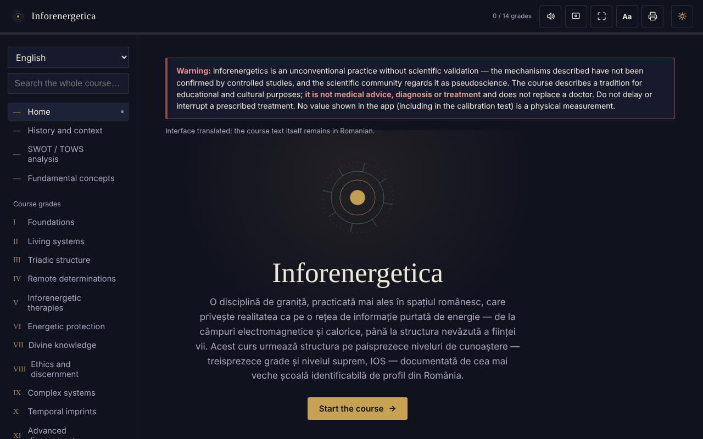

# Inforenergetica — interactive course

**English** · [Română](README.ro.md) · [Français](README.fr.md) · [Italiano](README.it.md) · [Español](README.es.md) · [Português](README.pt.md) · [Deutsch](README.de.md) · [Magyar](README.hu.md)

**Version:** 2.0.2 · **Last updated:** 2026-10-27

**Status:** stable; descriptive study (no therapeutic claims) · **Offline:** complete (no network requests)

Interface languages: **Română, English, Français, Italiano, Español, Português (PT), Deutsch, Magyar**

An offline educational course in a single HTML file about inforenergetics (13 grades plus the IOS level), with SWOT/TOWS analysis, a glossary and a self-assessment.

**Live app:** https://chiuta.github.io/Inforenergetica/

## Disclaimer

Inforenergetics is an unconventional practice **without scientific validation**: the mechanisms described have not been confirmed by controlled studies, and the scientific community regards it as pseudoscience. The application describes a tradition, for educational and cultural purposes. **It is not medical advice, diagnosis or treatment** and does not replace a doctor. Do not delay or interrupt a prescribed treatment. The same warning is permanently displayed in the app, on every section.

## What it is

An educational synthesis in Romanian, structured into 13 successive grades and the "supreme" level IOS, which follows the structure of a specialised school in Romania (historical attribution presented in the app, not independently verified here). The application states that it does not represent the official material of any school.

## Features

Verified in the code and in the browser:
- Navigation by sections: Home, History and context, SWOT / TOWS analysis, Fundamental concepts, Grades I–XIII, IOS, Personal journal, Calibration test, Glossary, Self-assessment, Resources.
- The domain's SWOT analysis and TOWS matrix (8 cards: 4 SWOT + 4 TOWS strategies).
- Calibration test: four positions, one chosen at random in each round (`crypto.getRandomValues` generator, with a `Math.random` fallback); it shows rounds, hits and the standard deviation expected by chance. It does not measure any energy or ability.
- Direct links to sections (`#grad-3`, `#swot`, etc.) and working browser "Back"/"Forward" buttons between sections; the address contains no personal data and nothing is stored.
- Search across the whole course and the glossary, ignoring diacritics.
- Self-assessment with 12 questions.
- Personal journal (.txt download, copy to clipboard, clear); optionally, a "Keep the journal in this browser" checkbox (off by default); a warning when leaving the page if there is text that has been neither downloaded nor kept.
- Text size: the "Aa" button in the top bar cycles through 100% / 115% / 130%.
- Light/dark theme, read-aloud (the browser's speech synthesis), keep screen awake (Wake Lock), full screen, printing / PDF export of the whole course.

## User guide

1. Open the page and read the warning at the top.
2. Choose a section from the left-hand menu (on mobile: the ☰ button; Escape closes it).
3. Go through the grades in order or look up a term in "Search the whole course".
4. In "Calibration test" press a position; the result is purely statistical, ~25% in the long run.
5. In "Personal journal" write your notes and press "Download journal" before closing the page.
6. "Self-assessment" checks only your understanding of the course material.
7. The printer button opens the print dialog for the whole course.

## Privacy and network

- Storage: by default the application stores nothing (no `sessionStorage`, IndexedDB or cookies either). The only exception is the "Keep the journal in this browser" option, which you enable yourself: the journal text is then saved to `localStorage` (keys `inforenergetica-jurnal` and `inforenergetica-jurnal-pastrat`), on this device only; unchecking it or "Clear" deletes it. If the option is off, the journal and progress are lost on closing/reloading, and the journal is kept only if you download it. The text size is not remembered.
- Network: I found no `fetch`, script, font, image or external link in the code; there are no external hosts. The page's CSP blocks any external connection.
- Permissions: none requested by the application. Optionally, when you press the buttons: speech synthesis, Wake Lock, full screen, clipboard, vibration (on devices that have it), native sharing (the "Share the result" button, only if the browser offers it).
- Zero telemetry, no account.

## Limits and warnings

- The content presents the claims of the tradition as it formulates them; they are not scientifically proven.
- "Inforenergetic power", "diagnosis" and "teledetermination" are not physical measurements.
- The historical references to people and organisations in the "History and context" section come from the text and have not been independently verified.
- Progress ("X / 14 grades") shows only the sections opened in the current session.

## Running locally / offline

Download `index.html` and open it in a browser; it needs neither internet nor a server.

## Evidence panel: sources (2026-10-27)

A **"What the evidence says"** note (key `ev_html`, 8 languages) now sits under the permanent disclaimer: no published meta-analyses, systematic reviews or controlled trials were found for inforenergetics as such ("source to be completed"); related "biofield" practices are cited via Jain & Mills, *Int J Behav Med* 2010;17(1):1-16. No therapeutic claim.

### Source check (2026-10-27, 2.0.2)

- **Jain & Mills, Int J Behav Med 2010**: title and DOI 10.1007/s12529-009-9062-4 confirmed (eScholarship record; abstract: strong evidence for pain reduction in pain populations, moderate in some groups, equivocal elsewhere, "need for further high-quality studies"). The volume/issue/pages `17(1):1-16` were not visible on the pages I could open, so they stay unconfirmed.
- **Added** (related practice, not inforenergetics itself): Memorial Sloan Kettering Cancer Center, "BioResonance Therapy" (page updated 25 Feb 2021): "Bioresonance therapies are based on unproven theories." The page was opened and its content read; it covers bioresonance, which is related but not identical to what the course teaches.
- For inforenergetics as such: still no meta-analysis, systematic review or controlled trial found; marked "source to be completed".

## History / Changelog

### 1.2.4 — 2026-10-22

fff-kit 1.1.4: touch targets and minimum text size. Touch targets/text fixed in the app.

### 1.2.3 — 2026-10-22

fff-kit 1.1.2: PBKDF2 with 600,000 iterations, anti-clickjacking protection.

### 1.2.2 — 2026-10-22
- Native browser confirm()/prompt() boxes replaced by own dialogs translated into the 8 languages (clearing the journal); text of at least 12 px on mobile.

### 1.1.0 — 2026-10-14
- Backup and data labelling (fff-kit).

### 12 October 2026 — version 1.0.0
- 1.0.0 — 2026-10-12: the version and the date of the last update are displayed in the app

### 11 October 2026 (rev. 3)
- Navigation between sections is reflected in the address (`#id`): direct links, working "Back"/"Forward" button, an invalid or unknown hash leads to Home. No storage is added. CSP: hash recalculated.

### 11 October 2026 (rev. 2)
- Journal: optional (opt-in) local storage and a warning when leaving the page with unsaved text; the status field is announced by screen readers (`role="status"`).
- "Aa" button for text size (100/115/130%); the top bar does not overflow the width at 360 px.
- The warning about the lack of scientific validation remains unchanged.

### 11 October 2026
- Personal journal: below the text field the character count and the fact that the text is not saved automatically are now displayed permanently (previously the status field stayed empty until an action).
- Accessibility: the top bar is a `<header>`; axe-core reports 0 violations at 1280 and 360 px.
- CSP: `script-src` uses a SHA-256 hash instead of `'unsafe-inline'` (the app has no inline handlers).
- The warning about the lack of scientific validation remains unchanged.

## License

MIT — see the LICENSE file.

## Author

Alexio — Alexandru-Ionuț Chiuță, contact: alexio@trom.tf

## Summary

Inforenergetica is a single-file, offline, Romanian-language educational course on "inforenergetics", a non-conventional practice with no scientific validation (considered pseudoscience by the scientific community). It includes 13 grades plus a top level, a SWOT/TOWS analysis, glossary, a quiz and a chance-based "calibration" game that measures nothing. A permanent disclaimer states it is not medical advice. No storage, no external requests, no telemetry.
