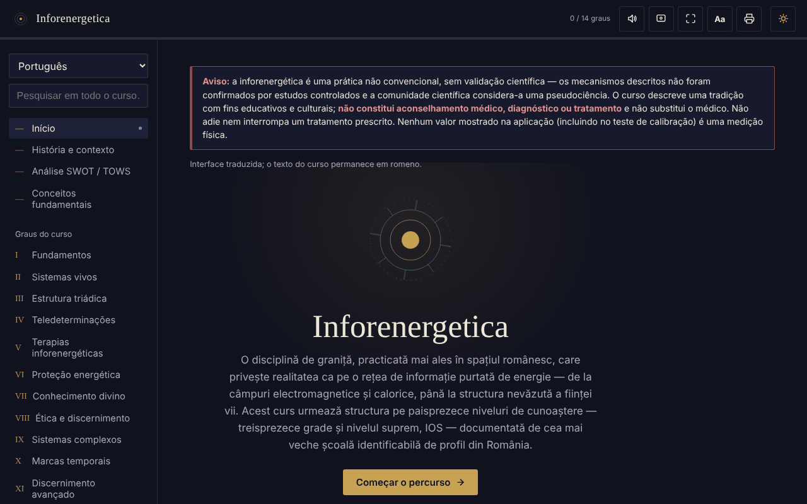

# Inforenergetica — curso interativo

[English](README.md) · [Română](README.ro.md) · [Français](README.fr.md) · [Italiano](README.it.md) · [Español](README.es.md) · **Português** · [Deutsch](README.de.md) · [Magyar](README.hu.md)

**Versão:** 2.0.0 · **Última atualização:** 2026-10-26

Idiomas da interface: **Română, English, Français, Italiano, Español, Português (PT), Deutsch, Magyar**

Curso educativo offline, num único ficheiro HTML, sobre a inforenergética (13 graus mais o nível IOS), com análise SWOT/TOWS, glossário e autoavaliação.

**Aplicação online:** https://chiuta.github.io/Inforenergetica/

## Aviso

A inforenergética é uma prática não convencional, **sem validação científica**: os mecanismos descritos não foram confirmados por estudos controlados e a comunidade científica considera-a uma pseudociência. A aplicação descreve uma tradição, com fins educativos e culturais. **Não é aconselhamento médico, diagnóstico nem tratamento** e não substitui o médico. Não adie nem interrompa um tratamento prescrito. O mesmo aviso é apresentado de forma permanente na aplicação, em cada secção.

## O que é

Uma síntese educativa em romeno, estruturada em 13 graus sucessivos e no nível «supremo» IOS, que segue a estrutura de uma escola da área na Roménia (atribuição histórica apresentada na aplicação, não verificada aqui de forma independente). A aplicação declara que não representa o material oficial de nenhuma escola.

## Funcionalidades

Verificadas no código e no navegador:
- Navegação por secções: Início, História e contexto, Análise SWOT / TOWS, Conceitos fundamentais, Graus I–XIII, IOS, Diário pessoal, Teste de calibração, Glossário, Autoavaliação, Recursos.
- A análise SWOT e a matriz TOWS da área (8 cartões: 4 SWOT + 4 estratégias TOWS).
- Teste de calibração: quatro posições, uma escolhida ao acaso em cada ronda (gerador `crypto.getRandomValues`, com `Math.random` como alternativa); mostra rondas, acertos e o desvio-padrão esperado por puro acaso. Não mede qualquer energia ou capacidade.
- Ligações diretas às secções (`#grad-3`, `#swot`, etc.) e botões «Anterior»/«Seguinte» do navegador funcionais entre secções; o endereço não contém dados pessoais e nada é guardado.
- Pesquisa em todo o curso e no glossário, ignorando os sinais diacríticos.
- Autoavaliação com 12 perguntas.
- Diário pessoal (transferência .txt, cópia para a área de transferência, limpeza); opcionalmente, a caixa «Manter o diário neste navegador» (desativada por predefinição); aviso ao sair da página se houver texto não transferido nem mantido.
- Tamanho do texto: o botão «Aa» da barra superior percorre 100% / 115% / 130%.
- Tema claro/escuro, leitura em voz alta (síntese de voz do navegador), ecrã ativo (Wake Lock), ecrã inteiro, impressão / exportação em PDF de todo o curso.

## Manual de utilização

1. Abra a página e leia o aviso no topo.
2. Escolha uma secção no menu da esquerda (no telemóvel: o botão ☰; Escape fecha-o).
3. Percorra os graus por ordem ou procure um termo em «Pesquisar em todo o curso».
4. Em «Teste de calibração» prima uma posição; o resultado é puramente estatístico, ~25% a longo prazo.
5. Em «Diário pessoal» escreva as suas notas e prima «Transferir o diário» antes de fechar a página.
6. A «Autoavaliação» verifica apenas a compreensão do material do curso.
7. O botão da impressora abre a caixa de impressão de todo o curso.

## Privacidade e rede

- Armazenamento: por predefinição a aplicação não guarda nada (nem `sessionStorage`, IndexedDB ou cookies). A única exceção é a opção «Manter o diário neste navegador», que ativa por si: nesse caso o texto do diário é guardado em `localStorage` (chaves `inforenergetica-jurnal` e `inforenergetica-jurnal-pastrat`), apenas neste dispositivo; desmarcá-la ou «Limpar» elimina-o. Se a opção estiver desativada, o diário e o progresso perdem-se ao fechar/recarregar, e o diário só é conservado se o transferir. O tamanho do texto não é memorizado.
- Rede: não encontrei no código nenhum `fetch`, script, tipo de letra, imagem ou ligação externa; não há anfitriões externos. A CSP da página bloqueia qualquer ligação externa.
- Permissões: nenhuma pedida pela aplicação. Opcionalmente, ao premir os botões: síntese de voz, Wake Lock, ecrã inteiro, área de transferência, vibração (em dispositivos que a tenham), partilha nativa (botão «Partilhar o resultado», apenas se o navegador a oferecer).
- Zero telemetria, sem conta.

## Limites e avisos

- O conteúdo apresenta as afirmações da tradição tal como ela as formula; não estão provadas cientificamente.
- A «potência inforenergética», o «diagnóstico» e a «teledeterminação» não são medições físicas.
- As referências históricas a pessoas e organizações na secção «História e contexto» provêm do texto e não foram verificadas de forma independente.
- O progresso («X / 14 graus») mostra apenas as secções abertas na sessão atual.

## Execução local / offline

Transfira `index.html` e abra-o no navegador; não precisa de internet nem de servidor.

## Histórico / Changelog

### 1.2.4 — 2026-10-22

fff-kit 1.1.4: áreas de toque e texto mínimo. Áreas de toque/texto corrigidos na aplicação.

### 1.2.3 — 2026-10-22

fff-kit 1.1.2: PBKDF2 com 600.000 iterações, proteção anti-clickjacking.

### 1.2.2 — 2026-10-22
- As caixas confirm()/prompt() do navegador substituídas por diálogos próprios traduzidos nos 8 idiomas (limpar o diário); texto de pelo menos 12 px no telemóvel.

### 1.1.0 — 2026-10-14
- Cópia de segurança e etiquetagem de dados (fff-kit).

### 12 de outubro de 2026 — versão 1.0.0
- 1.0.0 — 2026-10-12: a versão e a data da última atualização são apresentadas na aplicação

### 11 de outubro de 2026 (rev. 3)
- A navegação entre secções reflete-se no endereço (`#id`): ligações diretas, botões «Anterior»/«Seguinte» funcionais, um hash inválido ou desconhecido leva ao Início. Não é acrescentado armazenamento. CSP: hash recalculado.

### 11 de outubro de 2026 (rev. 2)
- Diário: conservação local opcional (opt-in) e aviso ao sair da página com texto não guardado; o campo de estado é anunciado pelos leitores de ecrã (`role="status"`).
- Botão «Aa» para o tamanho do texto (100/115/130%); a barra superior não excede a largura a 360 px.
- O aviso sobre a falta de validação científica mantém-se inalterado.

### 11 de outubro de 2026
- Diário pessoal: por baixo do campo de texto passam a ser apresentados de forma permanente o número de carateres e o facto de o texto não ser guardado automaticamente (anteriormente o campo de estado ficava vazio até haver uma ação).
- Acessibilidade: a barra superior é um `<header>`; o axe-core reporta 0 violações a 1280 e 360 px.
- CSP: `script-src` usa um hash SHA-256 em vez de `'unsafe-inline'` (a aplicação não tem manipuladores inline).
- O aviso sobre a falta de validação científica mantém-se inalterado.

## Licença

MIT — ver o ficheiro LICENSE.

## Autor

Alexio — Alexandru-Ionuț Chiuță, contacto: alexio@trom.tf

## Resumo

Inforenergetica é um curso educativo em romeno, num único ficheiro e offline, sobre a «inforenergética», uma prática não convencional sem validação científica (considerada pseudociência pela comunidade científica). Inclui 13 graus mais um nível superior, uma análise SWOT/TOWS, um glossário, um questionário e um jogo de «calibração» baseado no acaso que não mede nada. Um aviso permanente indica que não é aconselhamento médico. Sem armazenamento, sem pedidos externos, sem telemetria.
