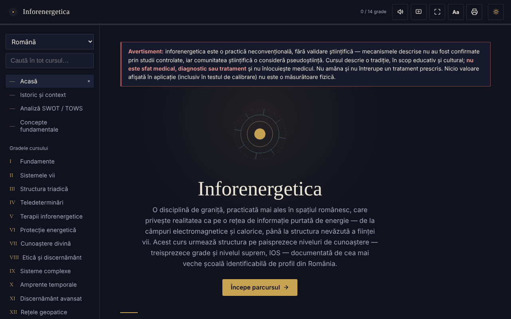

# Inforenergetica — curs interactiv

[English](README.md) · **Română** · [Français](README.fr.md) · [Italiano](README.it.md) · [Español](README.es.md) · [Português](README.pt.md) · [Deutsch](README.de.md) · [Magyar](README.hu.md)

**Versiune:** 1.2.7 · **Ultima actualizare:** 2026-10-26

Limbile interfeței: **Română, English, Français, Italiano, Español, Português (PT), Deutsch, Magyar**

Curs educațional offline, într-un singur fișier HTML, despre inforenergetică (13 grade + nivelul IOS), cu analiză SWOT/TOWS, glosar și autoevaluare.

**Live:** https://chiuta.github.io/Inforenergetica/

## Avertisment

Inforenergetica este o practică neconvențională, **fără validare științifică**: mecanismele descrise nu au fost confirmate prin studii controlate, iar comunitatea științifică o consideră pseudoștiință. Aplicația descrie o tradiție, în scop educativ și cultural. **Nu este sfat medical, diagnostic sau tratament** și nu înlocuiește medicul. Nu amâna și nu întrerupe un tratament prescris. Același avertisment este afișat permanent în aplicație, pe fiecare secțiune.

## Ce este

O sinteză educațională în limba română, structurată pe 13 grade succesive și nivelul „suprem” IOS, care urmează structura unei școli de profil din România (atribuire istorică prezentată în aplicație, neverificată independent aici). Aplicația declară că nu reprezintă materialul oficial al vreunei școli.

## Funcții

Verificate în cod și în browser:
- Navigare pe secțiuni: Acasă, Istoric și context, Analiză SWOT / TOWS, Concepte fundamentale, Gradele I–XIII, IOS, Jurnal personal, Test de calibrare, Glosar, Autoevaluare, Resurse.
- Analiza SWOT și matricea TOWS a domeniului (8 carduri: 4 SWOT + 4 strategii TOWS).
- Test de calibrare: patru poziții, una aleasă la întâmplare la fiecare rundă (generator `crypto.getRandomValues`, cu rezervă `Math.random`); afișează runde, nimeriri și abaterea tipică așteptată din hazard. Nu măsoară nicio energie sau abilitate.
- Legături directe către secțiuni (`#grad-3`, `#swot` etc.) și butonul „Înapoi”/„Înainte” al browserului între secțiuni; adresa nu conține date personale și nu se stochează nimic.
- Căutare în tot cursul și în glosar, cu ignorarea diacriticelor.
- Autoevaluare cu 12 întrebări.
- Jurnal personal (descărcare .txt, copiere în clipboard, golire); opțional, casetă „Păstrează jurnalul în acest browser” (implicit oprită); avertisment la părăsirea paginii dacă există text nedescărcat și nepăstrat.
- Mărime text: butonul „Aa” din bara de sus parcurge 100% / 115% / 130%.
- Temă deschisă/închisă, citire cu voce tare (sinteza vocală a browserului), ecran activ (Wake Lock), ecran complet, printare / export PDF a întregului curs.

## Manual de utilizare

1. Deschide pagina și citește avertismentul din partea de sus.
2. Alege o secțiune din meniul din stânga (pe mobil: butonul ☰; Escape îl închide).
3. Parcurge gradele în ordine sau caută un termen în „Caută în tot cursul”.
4. În „Test de calibrare” apasă o poziție; rezultatul este pur statistic, ~25% pe termen lung.
5. În „Jurnal personal” scrie însemnări și apasă „Descarcă jurnalul” înainte de a închide pagina.
6. „Autoevaluare” verifică doar înțelegerea materialului de curs.
7. Butonul de imprimantă deschide dialogul de printare pentru tot cursul.

## Confidențialitate și rețea

- Storage: implicit aplicația nu stochează nimic (nici `sessionStorage`, IndexedDB sau cookie-uri). Singura excepție este opțiunea „Păstrează jurnalul în acest browser”, pe care o activezi tu: atunci textul jurnalului se salvează în `localStorage` (chei `inforenergetica-jurnal` și `inforenergetica-jurnal-pastrat`), doar pe acest dispozitiv; debifarea sau „Golește” îl șterge. Dacă opțiunea e oprită, jurnalul și progresul se pierd la închidere/reîncărcare, iar jurnalul se păstrează doar dacă îl descarci. Mărimea textului nu se reține.
- Rețea: nu am găsit niciun `fetch`, script, font, imagine sau link extern în cod; nu există gazde externe. Politica CSP din pagină blochează orice conexiune externă.
- Permisiuni: niciuna cerută de aplicație. Opțional, la apăsarea butoanelor: sinteză vocală, Wake Lock, ecran complet, clipboard, vibrații (la dispozitive care le au), partajare nativă (butonul „Distribuie rezultatul”, doar dacă browserul o oferă).
- Zero telemetrie, fără cont.

## Limite și avertismente

- Conținutul prezintă afirmațiile tradiției așa cum sunt formulate de aceasta; nu sunt dovedite științific.
- „Puterea inforenergetică”, „diagnosticul” și „teledeterminarea” nu sunt măsurători fizice.
- Referirile istorice la persoane și organizații din secțiunea „Istoric și context” provin din text și nu au fost verificate independent.
- Progresul („X / 14 grade”) arată doar secțiunile deschise în sesiunea curentă.

## Rulare locală / offline

Descarcă `index.html` și deschide-l în browser; nu are nevoie de internet sau de server.

## Istoric / Changelog

### 1.2.4 — 2026-10-22

fff-kit 1.1.4: ținte tactile și text minim. Ținte tactile/text corectate în aplicație.

### 1.2.3 — 2026-10-22

fff-kit 1.1.2: PBKDF2 600 000 iterații, protecție anti-clickjacking.

### 1.2.2 — 2026-10-22
- Casetele confirm()/prompt() ale browserului înlocuite cu dialoguri proprii, traduse în cele 8 limbi (golirea jurnalului); text de minimum 12 px pe mobil.

### 1.1.0 — 2026-10-14
- Copie de rezervă și etichetare date (fff-kit).

### 12 octombrie 2026 — versiunea 1.0.0
- 1.0.0 — 2026-10-12: versiunea și data ultimei actualizări sunt afișate în aplicație

### 11 octombrie 2026 (rev. 3)
- Navigarea între secțiuni se reflectă în adresă (`#id`): legături directe, buton „Înapoi”/„Înainte” funcțional, hash invalid sau necunoscut duce la Acasă. Nu se adaugă stocare. CSP: hash recalculat.

### 11 octombrie 2026 (rev. 2)
- Jurnal: păstrare locală opțională (opt-in) și avertisment la părăsirea paginii cu text nesalvat; câmpul de stare este anunțat de cititoarele de ecran (`role="status"`).
- Buton „Aa” pentru mărimea textului (100/115/130%); bara de sus nu depășește lățimea la 360 px.
- Avertismentul privind lipsa validării științifice rămâne neschimbat.

### 11 octombrie 2026
- Jurnal personal: sub câmpul de text se afișează acum permanent numărul de caractere și faptul că textul nu se salvează automat (anterior câmpul de stare rămânea gol până la o acțiune).
- Accesibilitate: bara de sus este un `<header>`; axe-core raportează 0 încălcări la 1280 și 360 px.
- CSP: `script-src` folosește hash SHA-256 în loc de `'unsafe-inline'` (aplicația nu are handler-e inline).
- Avertismentul privind lipsa validării științifice rămâne neschimbat.

## Licență

MIT — vezi fișierul LICENSE.

## Autor

Alexio — Alexandru-Ionuț Chiuță, contact: alexio@trom.tf

## Rezumat

Inforenergetica este un curs educațional într-un singur fișier, offline, în limba română, despre „inforenergetică”, o practică neconvențională fără validare științifică (considerată pseudoștiință de comunitatea științifică). Include 13 grade plus un nivel superior, o analiză SWOT/TOWS, glosar, un test și un joc de „calibrare” bazat pe întâmplare, care nu măsoară nimic. Un avertisment permanent precizează că nu este sfat medical. Fără stocare, fără cereri externe, fără telemetrie.
